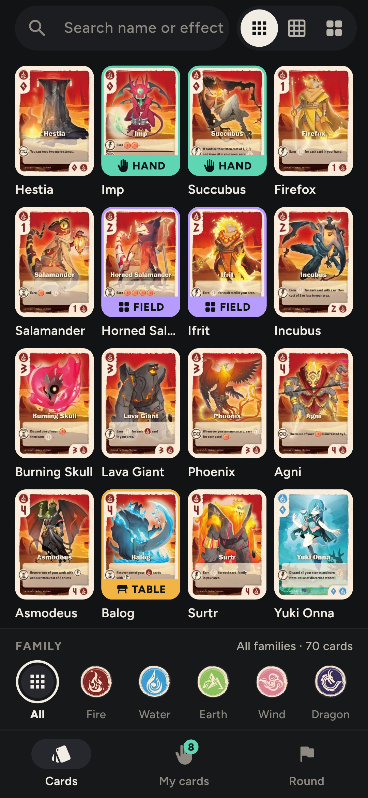
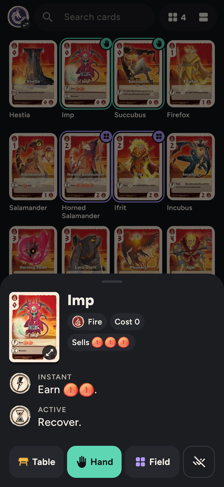
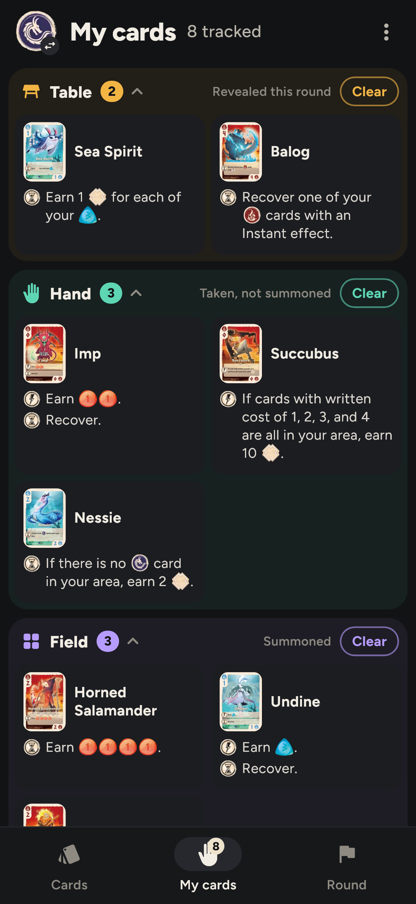
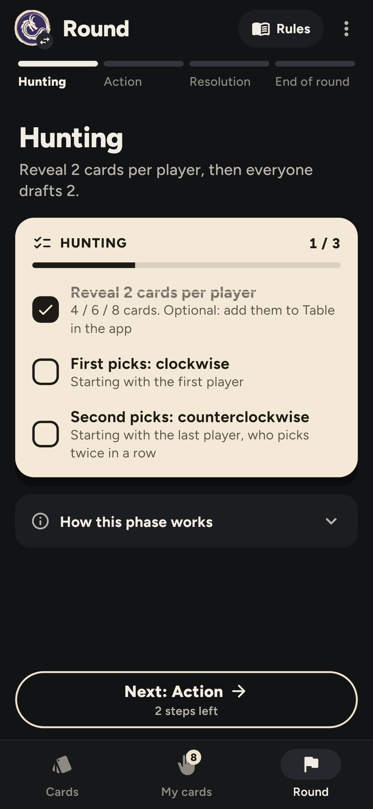

<p align="center">
  
</p>

# Babel Board

A phone app for playing board games whose cards you can't read.

## The problem it was built for

I play with someone who reads only Chinese. I read only English. Our games are Chinese
editions, so at the table I can recognise a card by its art but not read what it does. The
usual fixes are bad: a translation sheet you flip through, a phone photo you zoom into, or
asking every turn. Games like *Vale of Eternity* have 70 cards with effects that matter,
and rulings for how they combine.

Babel Board puts the English text one tap away from the picture, lets me track which
cards are mine, and walks the round's phases with a checklist so cleanup steps are not
forgotten. It lies on the table and gets glanced at between turns.

## Who it is for

- Anyone playing a board game in a language they don't read: imported editions, a
  partner's copy, a game bought abroad.
- Mixed-language tables, where one player needs the text and the other doesn't.
- People who want a rules companion for a specific game without waiting for an official app.

It is not a digital version of the game and it has no scoring, timers, or online play. It
is the card-text lookup and the "what do I do now" checklist, nothing more.

## What it does

<p align="center">
  
  
  
  
</p>

1. **Find the card by its picture.** A grid of all the cards, filtered by family and cost,
   with a rail to jump to a cost. Search by name or by a word in the effect.
2. **Read it in English.** Tap a card: its effect, with the game's own icons drawn inline,
   and the rulings for tricky interactions a drag away.
3. **Track your cards.** Put a card in Table, Hand or Field with a tap or a flick; move it
   between zones by dragging. The round's Resolution step lists the cards you have that
   need resolving.
4. **Follow the round.** Phases with a parchment checklist, "how this phase works" if you
   need it, and a Next button that nags when steps are unticked.

Everything works offline. Dark and light themes.

## Games as modules

The app ships with no games. Each game is a **module**: a folder (or a single JSON file) of
card data, pictures and rules text, built from a fixed set of screen types. Two are in this
repository, *Vale of Eternity* and *Magical Athlete*, and they are the worked examples for
adding your own.

Making a module needs no programming. Paste the instructions the app gives you into an AI
chat, describe the game, and install the file it answers with. The walkthrough is in
[docs/CREATING_MODULES.md](docs/CREATING_MODULES.md); the exact format is in
[modules/MODULE_SPEC.md](modules/MODULE_SPEC.md).

Modules contain the publishers' card art, so they are for personal use and shared privately.

## Getting it

Android only, sideloaded (no store). Build it yourself:

```bash
flutter build apk --release --split-per-abi
```

Install `build/app/outputs/flutter-apk/app-arm64-v8a-release.apk`. Then add games: Settings →
Repository, paste the link to a GitHub repository of packed modules, tap Connect, and tap
Install on the games you want. The button turns into Update when the repository has a newer
version, or Uninstall. A file or a direct link works too.

A web preview of the bundled games, for looking without a phone:

```bash
flutter build web --release
```

```bash
dart run tool/pack.dart modules build/web/modules --unpacked
```

then serve `build/web` (for example `node tool/serve.mjs build/web 8765`).

## Sharing modules with friends

Pack the module folders into a GitHub repository and give friends its link:

```bash
dart run tool/pack.dart modules ../babel-board-modules --name "Our games"
```

Commit and push that folder. The app lists the games and offers updates whenever a module's
`version` rises.

## For developers

How the code is put together: [docs/ARCHITECTURE.md](docs/ARCHITECTURE.md). Flutter,
Android plus web preview, `provider` and `shared_preferences`, no backend.

```bash
flutter test
```

```bash
flutter test tool/screenshot_test.dart
```

The second writes the screenshots in `design/screenshots/`.
